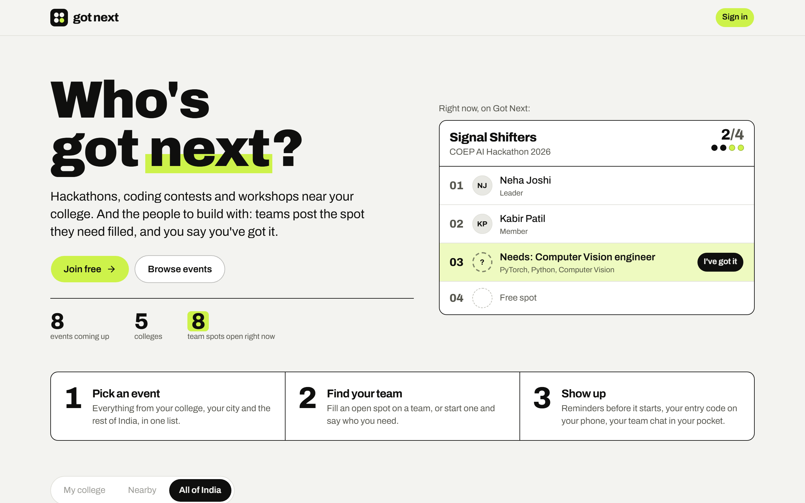
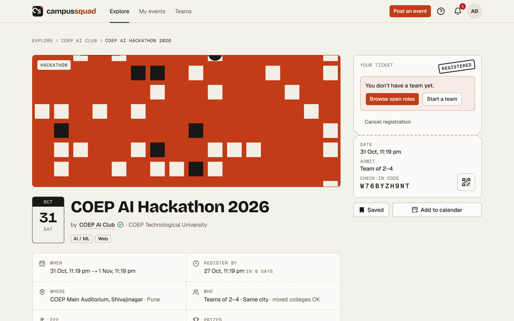
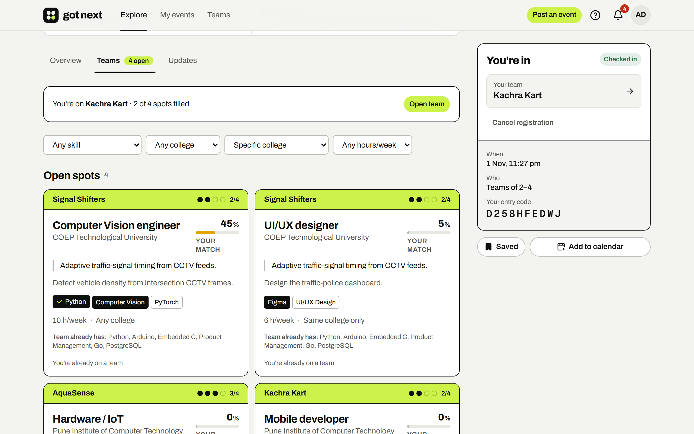
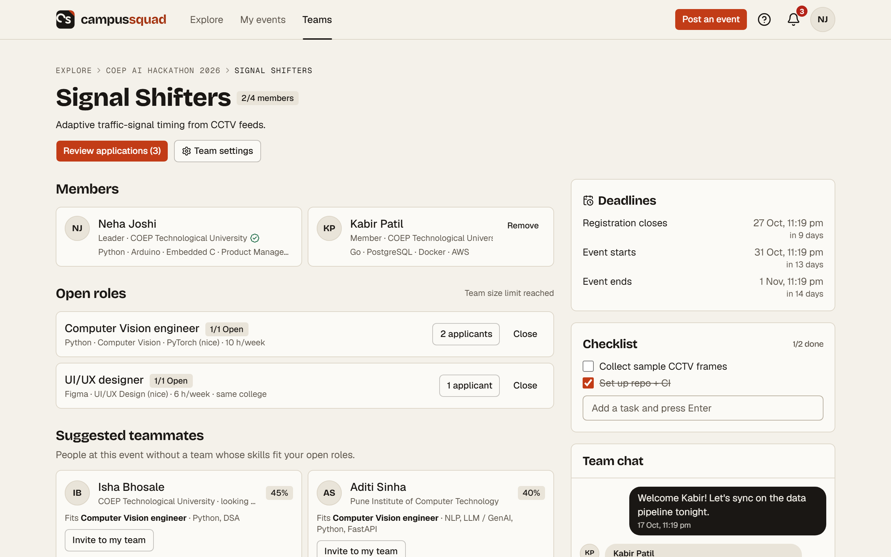
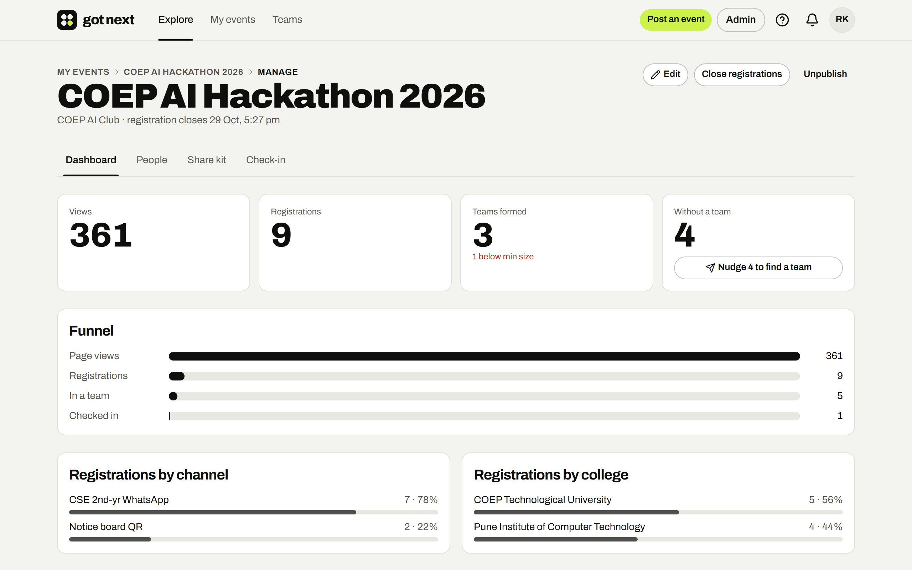
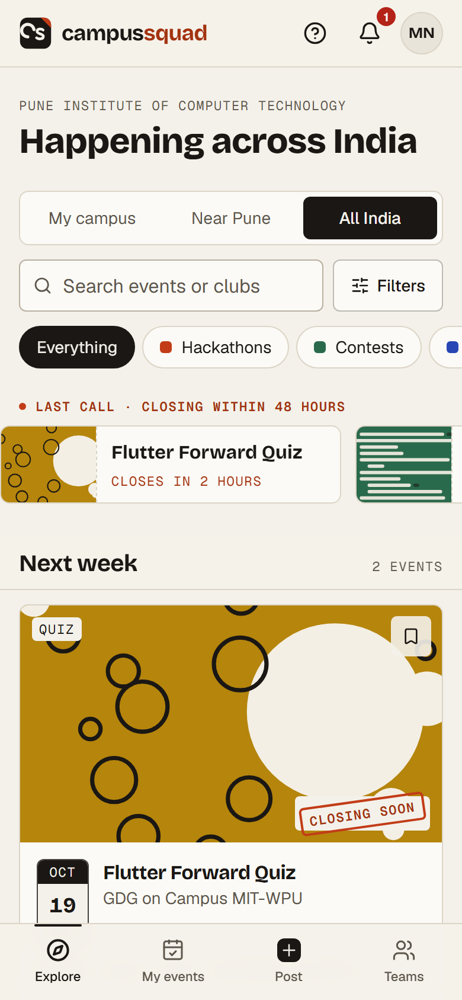

<div align="center">


# Got Next

**Who's got next?**

Campus tech events (hackathons, coding contests, quizzes, workshops, CTFs) in one feed,<br>
plus a team board where squads post open spots and students apply with their skills.

[](https://github.com/YashIsLive/CampusSquad/actions/workflows/ci.yml)


[Features](#what-it-does) · [Quick start](#quick-start) · [Demo accounts](#demo-accounts) · [Tests](#tests) · [Deploy](#deploy)

<br>

<picture>
  <source media="(prefers-color-scheme: dark)" srcset="docs/screenshots/landing-dark.png">
  
</picture>

</div>

## The problem

Campus events live in scattered WhatsApp forwards and Instagram stories. Registration deadlines slip by unseen, and
students who'd make a great team never meet because they're in different branches or colleges. Organizers can't tell
which poster or group actually brought people in.

Got Next gives each campus one list of events, shows every team's open spots so students can fill them, and gives organizers a real dashboard.

The name comes from pickup games: whoever says *"got next"* plays the next game. Here, a team is a row of spots (●●●○), and the open one is yours if you've got it. The whole design follows that idea; see [DESIGN.md](DESIGN.md).

## What it does

<table>
<tr>
<td width="50%" valign="top">

### For students
- Feed scoped to **My campus · Nearby · All India**, with filters, search (press <kbd>/</kbd>) and a "closing in 48 h" strip
- Save events, add them to Google Calendar, register solo or as a team
- A ticket with a **QR check-in code**
- Reminders 72 h, 24 h and 2 h before the start

</td>
<td width="50%" valign="top">

<picture>
  <source media="(prefers-color-scheme: dark)" srcset="docs/screenshots/event-dark.png">
  
</picture>

</td>
</tr>
<tr>
<td width="50%" valign="top">

<picture>
  <source media="(prefers-color-scheme: dark)" srcset="docs/screenshots/team-board-dark.png">
  
</picture>

</td>
<td width="50%" valign="top">

### Team board
- Teams post **open spots** with required and nice-to-have skills, hours/week and college rules
- Every open spot shows **your match score**, computed from your skill levels
- Students without a team list themselves as **free agents**, and team leads invite them
- Apply with a screening answer; leaders shortlist or accept, and **message applicants, who can reply** in a live conversation
- Accepting is **one database transaction**, so a team can never go over its size limit

</td>
</tr>
<tr>
<td width="50%" valign="top">

### Team room
- **Live** chat and a shared checklist (Supabase Realtime)
- Deadlines at a glance
- **Suggested teammates**: solo registrants ranked against your open spots
- After the event, teammates endorse each other's skills on their profiles

</td>
<td width="50%" valign="top">

<picture>
  <source media="(prefers-color-scheme: dark)" srcset="docs/screenshots/team-room-dark.png">
  
</picture>

</td>
</tr>
<tr>
<td width="50%" valign="top">

<picture>
  <source media="(prefers-color-scheme: dark)" srcset="docs/screenshots/dashboard-dark.png">
  
</picture>

</td>
<td width="50%" valign="top">

### For organizers
- Post an event in minutes: poster upload, Markdown rules, external registration link
- **Share kit**: tracked short links per channel, a QR code and a WhatsApp caption
- **Dashboard**: views → registrations → teams → check-ins, by channel and by college
- One click to nudge solo registrants to find a team
- Announcements, CSV export and **phone-camera QR check-in**
- Attendance feeds a **reliability score** on profiles

</td>
</tr>
</table>

<table>
<tr>
<td width="32%" valign="top">

<picture>
  <source media="(prefers-color-scheme: dark)" srcset="docs/screenshots/phone-dark.png">
  
</picture>

</td>
<td valign="top">

### Built for phones
Most students will open this from a WhatsApp link, so the phone layout is the main one: bottom navigation, filter
sheet, a sticky register bar, link previews for every event, and an **installable PWA**.

### And the rest
- **Sign-in:** Google, or email + password with a **one-time code on new devices** (trusted for 30 days), or an email link
- **Campus verification** three ways: college email domain, a **student ID photo** reviewed by an admin or a verified club lead (then deleted), or **vouches from two verified classmates**. Students can request a new college and an admin approves it
- **Clubs and communities** with admins and followers, who get notified when a new event goes live
- **First-run guide:** a checklist driven by what you've actually done, plus spotlight tours of each page
- **Skill suggestions** pulled from a student's public GitHub repos
- **Your data, your call:** download everything we hold, or delete your account, from **Account and privacy**; plain-language [privacy policy](src/app/privacy/page.tsx) and terms
- **Accessible:** keyboard navigable, reduced-motion aware, axe-checked to WCAG 2.1 AA in CI

</td>
</tr>
</table>

## Tech stack

| Layer | Choice |
| --- | --- |
| App | [Next.js 16](https://nextjs.org) App Router, React 19, TypeScript (strict), server actions |
| UI | Tailwind CSS v4, shadcn/ui on Base UI, lucide icons |
| Data | [Supabase](https://supabase.com) Postgres + [Drizzle ORM](https://orm.drizzle.team), Zod validation |
| Auth, live updates, files | Supabase Auth (Google, password, email), Realtime, Storage |
| Tests | Vitest (unit + DB integration), Playwright + axe-core (end-to-end, accessibility) |
| Hosting | Vercel + Supabase free tiers; daily cron for reminders |

## Quick start

You need Node 20+ and a free [Supabase](https://supabase.com) project.

```bash
git clone https://github.com/YashIsLive/CampusSquad.git
cd CampusSquad
npm install
cp .env.example .env.local   # fill in your Supabase keys (table below)
npm run db:migrate           # tables, triggers, row-level security, storage buckets
npm run db:seed              # demo data: 4 colleges, 30 students, 3 clubs, 8 events, teams
npm run dev                  # http://localhost:3000
```

### Try it on your phone

Phones on the same Wi-Fi can open the dev server at `http://<your-computer's-IP>:3000` (run `npm run dev -- -H 0.0.0.0`).
Dev mode compiles each page the first time you open it, so it feels slow. For a realistic feel, use a production build
instead:

```bash
npm run phone   # builds, then serves on http://<your-computer's-IP>:3001
```

<details>
<summary><b>Environment variables</b></summary>

<br>

| Variable | Where to find it | Used for |
| --- | --- | --- |
| `NEXT_PUBLIC_SUPABASE_URL` | Supabase → Project Settings → API | Auth, Realtime, Storage |
| `NEXT_PUBLIC_SUPABASE_ANON_KEY` | same | browser and server Supabase clients |
| `SUPABASE_SERVICE_ROLE_KEY` | same (secret) | seed script, account creation, demo login. **Server only** |
| `DATABASE_URL` | Project Settings → Database → Connection string → **Transaction pooler** (port 6543) | app queries |
| `DIRECT_URL` | same → **Session pooler** (port 5432) | migrations, seed, integration tests |
| `NEXT_PUBLIC_SITE_URL` | your URL (`http://localhost:3000` locally) | share links, link previews, email links |
| `AUTH_EMAIL_ENABLED` | `1` once custom SMTP is set up ([guide](docs/AUTH_SETUP.md)) | email sign-in links/codes, confirmation emails, new-device codes |
| `NEXT_PUBLIC_CONTACT_EMAIL` | an inbox you read | shown on /privacy and /terms for data requests; required on a real deployment |
| `AUTH_DEVICE_SECRET` | optional, any long random string | signs "remember this device" cookies; change it to make every browser confirm again |
| `RESEND_API_KEY`, `EMAIL_FROM` | optional, [resend.com](https://resend.com) | announcement and reminder emails (skipped if unset) |
| `CRON_SECRET` | any random string | protects `/api/cron/deadline-reminders` |
| `GITHUB_TOKEN` | optional, a GitHub token with no scopes | raises the GitHub API limit for skill suggestions |
| `E2E_TEST_LOGIN` | `1` **only locally** | enables the demo login |

The app refuses to start in production with missing or unsafe settings (see [`src/env.ts`](src/env.ts)).

</details>

<details>
<summary><b>Sign-in setup (Google and email)</b></summary>

<br>

Password sign-up works out of the box. Google and email need a few Supabase dashboard settings. The full walkthrough is in
[`docs/AUTH_SETUP.md`](docs/AUTH_SETUP.md). In short:

1. **Google:** Authentication → Providers → Google. The button appears on its own once enabled.
2. **Email:** add custom SMTP (Brevo's free tier works), paste in the provided email templates so links work on any
   device, add `/auth/confirm` to the redirect URLs, then set `AUTH_EMAIL_ENABLED=1`.

</details>

## Demo accounts

With `E2E_TEST_LOGIN=1`, the sign-in page lists a **demo cast** you can sign in as with one click:

| Who | What to try |
| --- | --- |
| **Riya Kulkarni**, organizer and admin | the event dashboard, share kit, check-in, `/admin` |
| **Aarav Deshmukh**, free agent | the feed, applying for spots, listing yourself as a free agent |
| **Neha Joshi**, team leader | reviewing applications, the team room, suggested teammates |
| **Dev Agarwal**, team leader at another college | cross-college teams |
| **Meera Nair**, applicant | application status updates arriving live |

Demo users have `*.seed.test` addresses and never receive email. The demo login is disabled in production builds. To
see the first-run guide, create a fresh account.

To make a real account an admin: `npm run make-admin -- you@college.edu` (add `--revoke` to undo).

## Tests

```bash
npm test             # Vitest: 61 unit and database integration tests
npm run test:e2e     # Playwright: 25 end-to-end tests, including axe accessibility checks
```

<details>
<summary><b>What the suites cover</b></summary>

<br>

| Suite | Covers |
| --- | --- |
| `tests/*.test.ts` | match score, eligibility, reminders, reliability, GitHub skill mapping, teammate ranking, feed grouping; the accept-application transaction and database integrity rules; **API lockdown** (someone holding the public anon key can't read emails, make themselves admin or tamper with data) |
| `e2e/auth.spec.ts` | redirect to sign-in and back, wrong password, password rules, instant sign-up, duplicate emails, expired links |
| `e2e/student.spec.ts` | feed scopes and filters, the <kbd>/</kbd> shortcut, save, register, ticket, cancel, start a team, add an open spot |
| `e2e/happy-path.spec.ts` | apply for a spot → team lead accepts → applicant sees it |
| `e2e/teams-realtime.spec.ts` | **live** chat and checklist between two browsers; invite → accept → join |
| `e2e/organizer.spec.ts` | post an event and notify followers, tracked links, CSV export, announcements, check-in, admin approval |
| `e2e/guide.spec.ts` | the first-run checklist and page tours |
| `e2e/conversations-verification.spec.ts` | leader ↔ applicant conversation, live both ways; verification by classmate vouches and by student ID review |
| `e2e/a11y-and-mobile.mobile.spec.ts` | phone layout, plus **axe WCAG 2.1 AA** on public and signed-in pages |

Integration tests need `DIRECT_URL` and the Supabase keys; without them they're skipped. End-to-end tests reseed the
database first (`E2E_RESEED=0` skips that). First run: `npx playwright install chromium`.

</details>

## How data stays consistent

The rules that matter are enforced **in Postgres**, not only in the UI:

| Rule | How |
| --- | --- |
| One team per student per event | unique index on `team_members(event_id, user_id)` |
| Team size never exceeds the limit | `team_members_guard` trigger (locks the team row) |
| Cross-college teams only where the event allows | `team_members_guard` and `vacancies_guard` triggers |
| One application per spot per student | unique index on `applications(vacancy_id, applicant_id)` |
| Endorsements only between teammates, after the event | `endorsements_guard` trigger |

Every table has row-level security, and the Supabase REST API is locked down
([`drizzle/0005_api_lockdown.sql`](drizzle/0005_api_lockdown.sql)): the app reads and writes only from the server, and the
browser can only subscribe to its own live updates. Schema: [`src/db/schema.ts`](src/db/schema.ts).

## Deploy

1. Import the repo in Vercel. CI ([`.github/workflows/ci.yml`](.github/workflows/ci.yml)) typechecks, lints, tests,
   builds and audits every push.
2. Add the environment variables. Set `NEXT_PUBLIC_SITE_URL` to your https URL and add a `CRON_SECRET`. **Don't** set
   `E2E_TEST_LOGIN`.
3. Run `npm run db:migrate` once against the production database. Never seed production (the seed script refuses).
4. Do the Supabase steps in [`docs/AUTH_SETUP.md`](docs/AUTH_SETUP.md) with your production URL.
5. Sign up, then `npm run make-admin -- you@college.edu` with the production environment.
6. Point an uptime monitor at `/api/health`. [`vercel.json`](vercel.json) schedules the daily reminder job.

<details>
<summary><b>Production checklist</b></summary>

<br>

- [x] Security headers and CSP, HSTS, no framing
- [x] REST API locked down; row-level security on every table; uploads limited to the owner's folder
- [x] Every server action validates input and checks permissions; per-user rate limits
- [x] Sign-in links work across devices; open redirects blocked
- [x] Real 404s, `robots.txt`, `sitemap.xml`, link-preview images for every event
- [x] WCAG 2.1 AA checks in CI; reduced motion respected
- [ ] Custom SMTP and email templates in Supabase ([guide](docs/AUTH_SETUP.md))
- [ ] Error tracking (e.g. Sentry); errors currently go to Vercel logs

</details>

## Project layout

```
src/app/          pages and server actions (feed, events, teams, clubs, profiles, admin)
src/lib/          auth, feed query, eligibility, match score, accept-application transaction, reminders
src/db/           Drizzle schema and client
drizzle/          SQL migrations (tables, triggers, row-level security, API lockdown)
scripts/          seed data, make-admin, README screenshots
tests/, e2e/      Vitest and Playwright suites
```

**More docs:** [product blueprint](BLUEPRINT.md) · [design language](DESIGN.md) · [plan and schema](PLAN.md) ·
[decision log](DECISIONS.md) · [auth setup](docs/AUTH_SETUP.md)

Screenshots are generated from the seed data with `npx tsx scripts/screenshots.ts` while the dev server is running.
